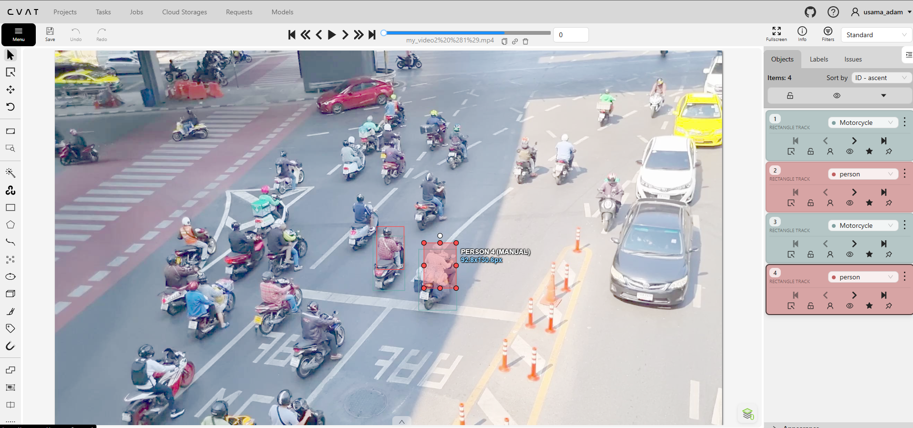
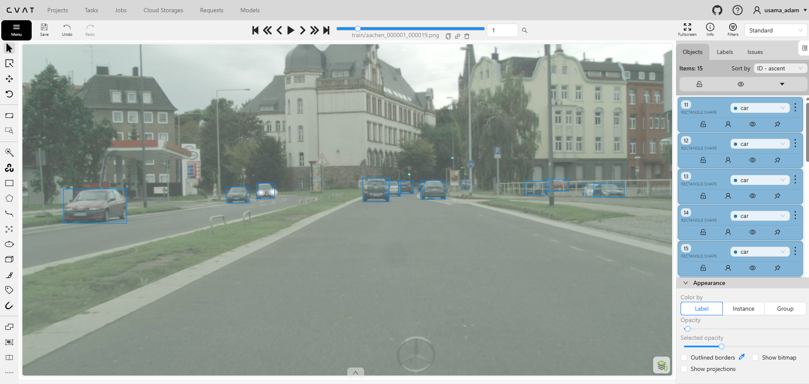
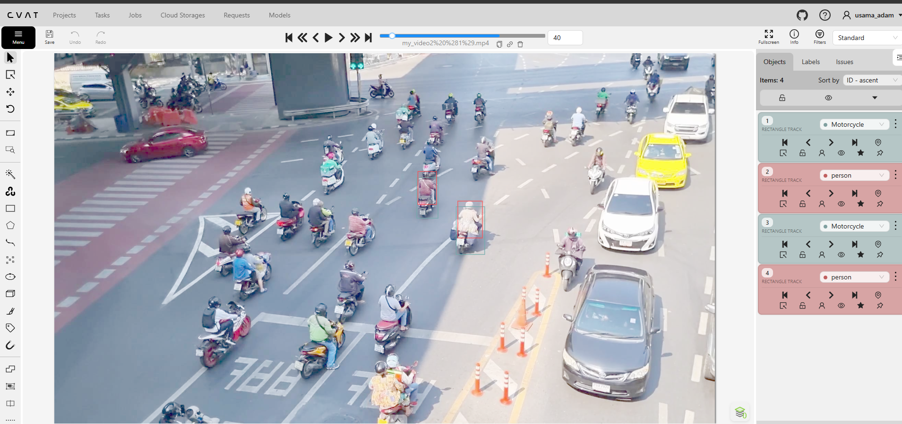

# CVAT 2D Object Tracking & Bounding Box Annotation

## Project Overview

This project demonstrates my practical experience with 2D object tracking, bounding-box annotation, and video annotation using CVAT.

The tracking exercise focuses on **four selected objects: two motorcycles and two people**. The objective is to maintain consistent object identities across video frames rather than annotate every visible road user.

## Video Demonstration

The video demonstrates my CVAT annotation workflow, object tracking, annotation decisions, and quality assurance process.

[Watch the full demonstration on YouTube](https://youtu.be/PD7wA10ZvYc)

## Annotation Screenshots

### 1. Four-Object Tracking

Four selected tracking targets: two motorcycles and two people, annotated using CVAT rectangle tracks.

### 2. Bounding Box Annotation

A separate image annotation exercise showing bounding boxes around cars at different distances.

### 3. Tracking Across Video Frames

The four selected tracking targets at frame 40, demonstrating the multi-frame annotation workflow.

## Annotation Workflow

1. Inspect the video and identify the four target objects.
2. Create bounding-box tracks using CVAT.
3. Assign the correct motorcycle and person labels.
4. Maintain consistent object identities across frames.
5. Review object movement and adjust bounding boxes.
6. Check tracking consistency and annotation accuracy.

## Quality Assurance

My review focuses on:

- Bounding-box placement
- Correct object labels
- Tracking ID consistency
- Missing or inaccurate annotations
- Keyframe and interpolation review
- Annotation corrections where necessary

## Tools and Skills

**Tool:** CVAT

**Skills:** 2D Object Tracking, Bounding Box Annotation, Video Annotation, Keyframe Review, Object Identity Management, and Annotation Quality Assurance.

## Portfolio

[View my complete Computer Vision Annotation Portfolio](https://github.com/Usamahmk/Computer-Vision-Annotation-Portfolio)
  
