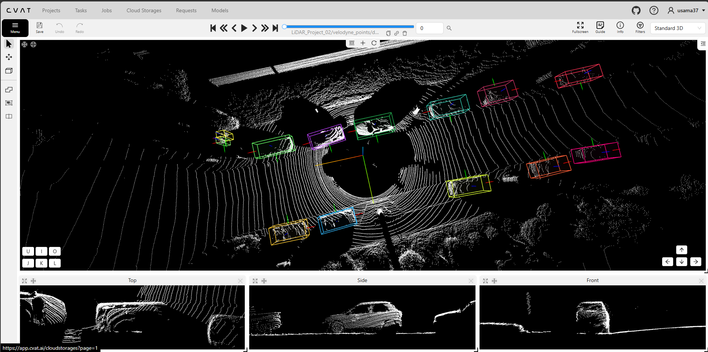
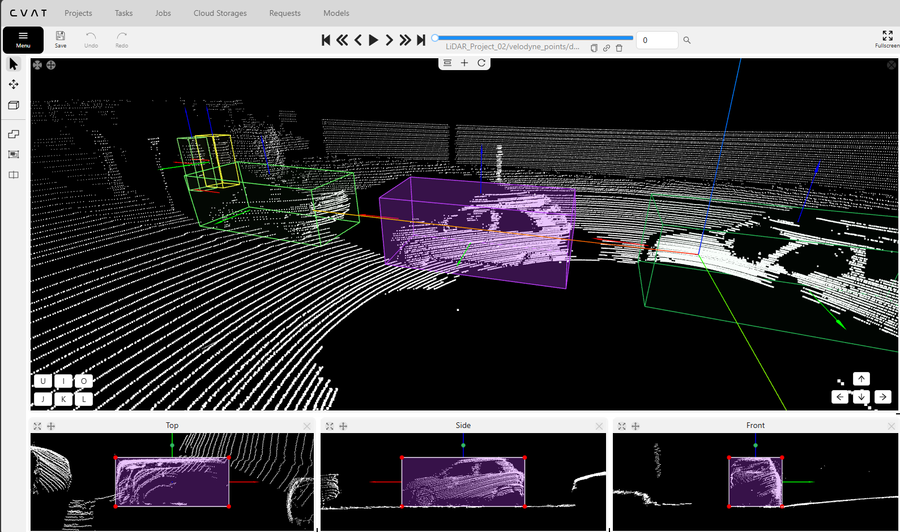
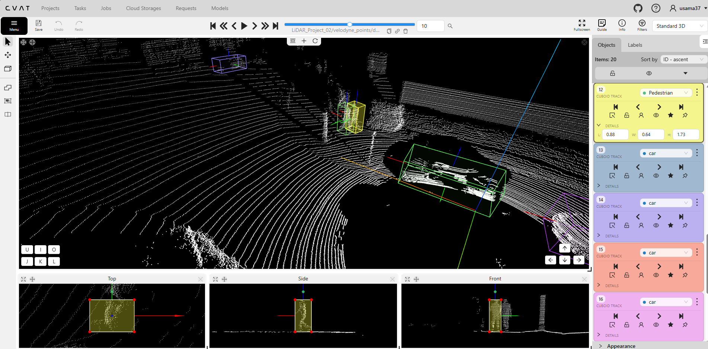
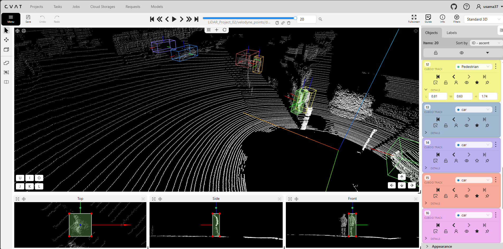
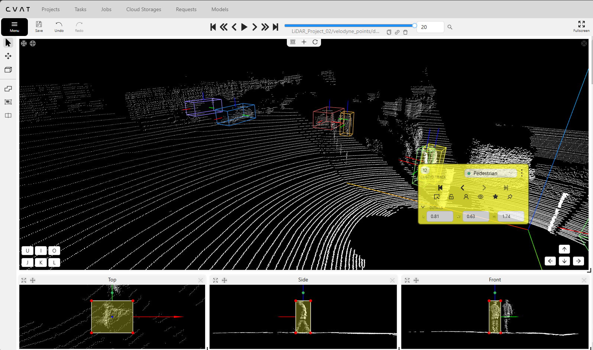

# LiDAR 3D Object Tracking & Point Cloud Annotation

## Project Overview

This project demonstrates practical experience in LiDAR 3D point-cloud annotation using CVAT, focusing on 3D cuboid placement, object classification, multi-frame tracking, and interpolation.

The portfolio includes two complementary forms of evidence:

## Dataset Source and Preparation

The LiDAR point-cloud data used in this project was obtained from the **KITTI dataset**, a widely used benchmark for autonomous driving and 3D object detection research.

For this portfolio project, I selected a subset of sequential LiDAR point-cloud samples from the original KITTI dataset rather than using the entire dataset.

The selected samples were uploaded to **CVAT (Computer Vision Annotation Tool)** for manual 3D cuboid annotation, object classification, and multi-frame object tracking.

### Data Preparation Workflow

1. Obtained LiDAR point-cloud data from the KITTI dataset.
2. Selected a smaller subset of sequential point-cloud samples.
3. Uploaded the selected samples into CVAT.
4. Configured the annotation task for 3D cuboid tracking.
5. Annotated objects and applied interpolation using variable keyframe intervals.
6. Inspected the annotations using 3D, top, side, and front views.

**Dataset Source:** [KITTI Vision Benchmark Suite](https://www.cvlibs.net/datasets/kitti/)

**1. Video Demonstration — Five-Frame Sample**

A recorded demonstration of the CVAT LiDAR annotation workflow, showing 3D bounding-box placement and object annotation across a five-frame sample.

**2. Screenshot Evidence — Sequential Object Tracking**

Screenshots from a larger LiDAR tracking task demonstrating 3D cuboid tracks, object identity management, and interpolation across sequential point-cloud frames.

The screenshots include different frame positions and multiple viewing angles for inspecting cuboid alignment, dimensions, and orientation.

### Skills Demonstrated

- 3D cuboid annotation in LiDAR point clouds
- Object classification, including cars and pedestrians
- Multi-frame object tracking
- Keyframe-based annotation and interpolation
- Cuboid dimension and orientation review
- Tracking identity consistency checks

## Video Demonstration

This video demonstrates my LiDAR 3D point-cloud annotation workflow in CVAT, including 3D cuboid annotation, object tracking, and interpolation across sequential frames.

**[Watch the full demonstration on YouTube](https://youtu.be/xC4R7dE_D-4)**
  

## Annotation Evidence

### 1. 3D Object Tracking — Frame 0

*Overview of the annotated LiDAR point cloud with multiple 3D cuboids and orthographic views.*

### 2. Cuboid Alignment and Orientation

*Selected 3D cuboid examined from perspective, top, side, and front views to assess spatial alignment.*

### 3. Tracking and Keyframe Workflow — Frame 10

*CVAT cuboid-track panel displaying object classes, tracking controls, and pedestrian cuboid dimensions at frame 10.*

### 4. Sequential Object Tracking — Frame 20

*Later LiDAR frame showing tracked objects, including pedestrian track ID 12, for temporal consistency review.*

### 5. Quality Assurance Inspection

*Inspection of a selected pedestrian cuboid and its dimensions using the available point-cloud views.*
## Annotation Workflow

1. Import the sequential LiDAR point-cloud dataset into CVAT.
2. Inspect the point-cloud scene and identify target objects.
3. Create 3D cuboids around selected objects.
4. Adjust cuboid position, dimensions, and orientation.
5. Track objects across the five-frame sequence.
6. Use interpolation to support annotation between frames.
7. Review object identities and cuboid alignment.
8. Correct identified annotation issues.

## Quality Assurance

The QA process focuses on:

- Accurate 3D cuboid placement
- Correct object classification
- Cuboid dimensions and orientation
- Consistent tracking identities
- Interpolation accuracy
- Annotation consistency across frames

**QA findings:** To be documented from the completed review.

## Supporting Documentation

- [Annotation Guidelines](annotation-guidelines.md)
- [Difficult Cases](difficult-cases.md)
- [Tracking QA Report](tracking-qa-report.md)

## Portfolio

[Back to Computer Vision Annotation Portfolio](../README.md)
